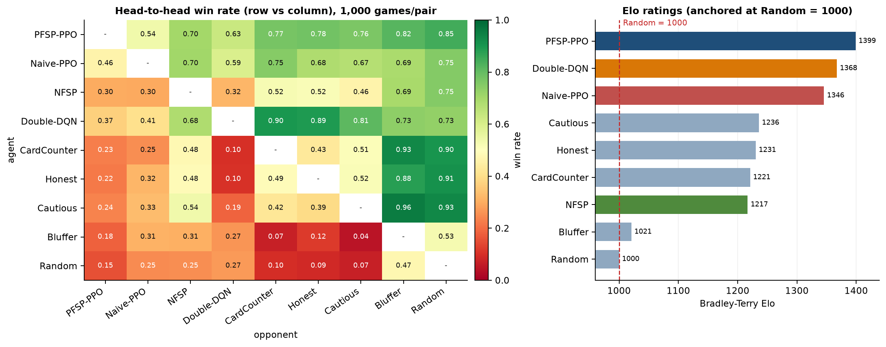
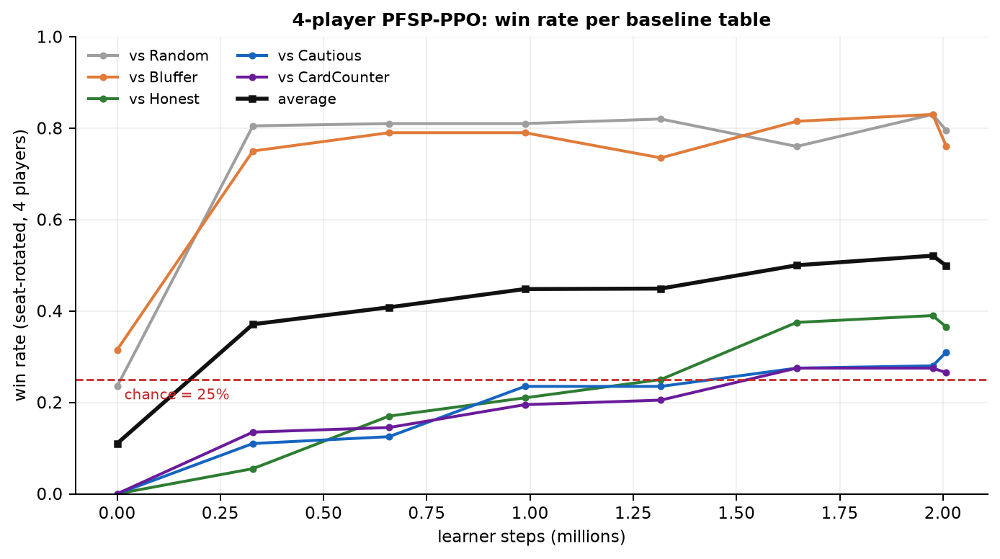
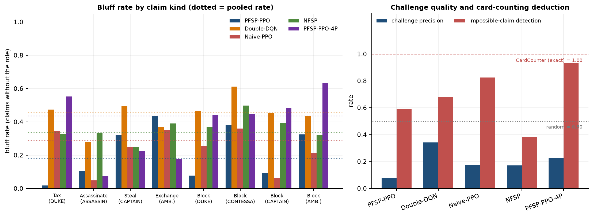
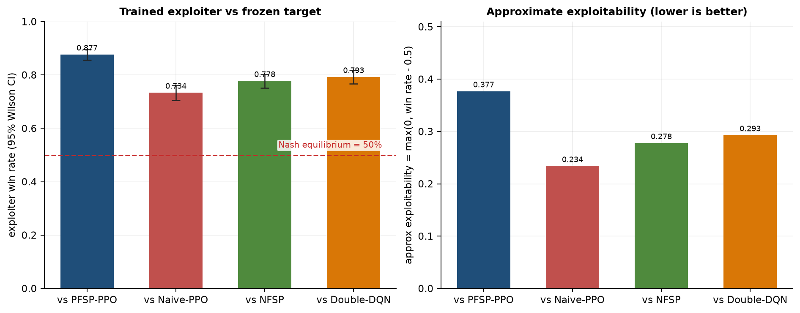
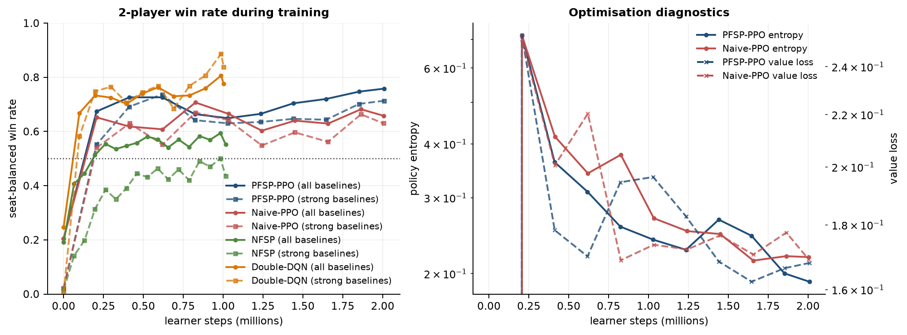

# rloup

Reinforcement learning for **Coup**, the official base game: a fast rules engine,
a PettingZoo `AECEnv`, five scripted baselines, masked self-play PPO (PFSP and
naive), masked NFSP, a comprehensive evaluation suite (round robin, Elo,
behavioural diagnostics, controlled card-counting probe, approximate
exploitability), publication figures, and an interactive CLI you can play
against the trained agents.

```
rloup/
├── constants.py        roles, phases, the flat discrete action space
├── engine.py           CoupEngine: full rules, ego-centric observations, telemetry
├── pet_env.py          CoupAECEnv: PettingZoo AEC wrapper
├── play.py             interactive / spectate / demo CLI
├── agents/
│   ├── base.py         Agent base class + observation parser
│   ├── baselines.py    Random / Honest / AggressiveBluffer / CautiousSkeptical / CardCounter
│   ├── ppo.py          MaskedActorCritic, PPOAgent, per-seat GAE buffer
│   ├── nfsp.py         Q/SL networks, replay + reservoir buffers, NFSPAgent
│   ├── dqn.py          Action-Masked DoubleDQNAgent (online + target Q-networks)
│   └── slm.py          SLMAgent + local llama-server GPU manager (OpenAI-compatible)
├── training/
│   ├── pool.py         OpponentPool: PFSP sampling, EMA win rates, Elo
│   ├── vec.py          seat-balanced benchmark shared by every trainer
│   ├── metrics.py      structured metrics.jsonl writer (one schema for all runs)
│   ├── train_ppo.py    vectorised batched-inference PPO (pfsp / naive / exploiter)
│   ├── train_nfsp.py   vectorised action-masked NFSP
│   └── train_dqn.py    vectorised action-masked Double DQN (pfsp / naive, 2-6P)
└── eval/
    ├── evaluate.py     round robin, Elo, 4P tables, behaviour, probe, exploitability
    ├── eval_slm.py     benchmark a local SLM bot against RL models & baselines
    └── plots.py        five 180-DPI figures from results/
```

## Headline results

2,000,000 PPO steps and 1,000,000 NFSP steps per agent, seed 42, RTX 5060 Ti
(16 GB).  All win rates are **seat balanced** and reported with exact 95% Wilson
intervals.

| Finding | Number |
| --- | --- |
| Best 2-player agent (round robin, 28,000 games) | **PFSP-PPO, Elo 1414.9** (Naive-PPO 1367.0, NFSP 1240.3, Random 1000) |
| PFSP-PPO vs every scripted baseline | 0.75 – 0.84 win rate (all CIs exclude 0.5) |
| PFSP-PPO vs Naive-PPO (the ablation) | 0.538 [0.507, 0.569] |
| 4-player agent vs 7 seat-rotated tables | 0.485 wins vs 0.25 chance, **average finish rank 1.89 of 4** |
| Provably-impossible claims challenged (N=1,000) | PFSP-PPO-4P 0.934, Naive-PPO 0.802, PFSP-PPO-2P 0.582, NFSP 0.370, CardCounter 1.000, Random 0.537 |
| Approximate exploitability (2P) | 0.369 (PFSP-PPO), 0.237 (Naive-PPO), 0.250 (NFSP) |
| Full evaluation wall time | 263.5 s for 63,000+ games, 3 exploiters, 16 snapshot benchmarks |

## Coup rules and edge cases verified

Official base game for 2–6 players: a 15-card Court deck (3 copies each of
Duke, Assassin, Captain, Ambassador, Contessa), two influence per player, 2
starting coins (the 2-player rule gives the starting player 1 coin and the
opponent 2), and coins that are public while hands are hidden.

Implemented and covered rule by rule in `tests/test_engine.py`:

- **Income / Foreign Aid** — Foreign Aid is blockable by Duke; Income is not.
- **Tax (Duke)**, **Assassinate (Assassin)**, **Steal (Captain)**, **Exchange
  (Ambassador)** — each main action claims a role and opens a challenge window
  for every other living player, in clockwise order.
- **Blocks** — Foreign Aid ↔ Duke, Assassinate ↔ Contessa, Steal ↔ Captain or
  Ambassador; each block reopens a challenge window for everyone downstream of
  the blocker.
- **Mandatory coup at 10+ coins** — at 10 coins only Coup is legal (the mask
  contains nothing else), which removes stalling.
- **Assassinate is paid up front** (3 coins) and refunded **only** when the
  challenge succeeds; a failed challenge costs the challenger one influence and
  the assassination still resolves.
- **Challenge resolution** — a proven claim returns the card to the deck,
  shuffles, draws a replacement, and the action continues; a caught bluff
  cancels the action and costs the claimant one influence.  The double-loss
  cases (e.g. challenge a block, lose, and then lose again to the action) are
  covered explicitly.
- **Exchange** — draw 2, keep any 2 of 4 (or 1 of 3 with one influence left),
  with duplicate keep-options collapsed to *canonical* indices so the legal mask
  never offers two identical outcomes.
- **Influence loss** — choosing between two different cards is a decision; with
  one card left or two identical cards the loss is forced (no wasted decision).
- **Checked invariants** over 1,000 randomized games per player count (2/3/4/6):
  15 cards always accounted for (hands + revealed + deck + exchange buffer),
  no illegal action ever accepted, termination always in a single winner, and
  no hidden information in any observation.

## Environment architecture

### Core engine (`rloup/engine.py`)

Pure Python + NumPy, no torch dependency, ~10k decisions/s in vectorised use.
`CoupEngine` exposes `reset / step / legal_mask / get_obs / get_episode_stats`
and keeps the full state machine (action → challenge poll → block poll → block
challenge → influence loss → resume).  Seats are `0..N-1`; "clockwise" is
increasing seat index modulo `N`.

### PettingZoo AEC env (`rloup/pet_env.py`)

`CoupAECEnv` is an `AECEnv` over the same engine: `observe(agent)` returns
`{"observation", "action_mask"}`, `step(action)` advances one decision, and the
wrapper passes `pettingzoo.test.api_test`.  Because the engine is an
agent-environment cycle, one "turn" is several `step` calls (the acting player,
then each challenger, then blocks, then influence loss).

### Observation (ego-centric, `131 + 21·N` floats)

Private part: own hand counts, plus the exchange buffer while exchanging.
Public part: per-relative-seat tableau (alive, influence, coins, three coin
thresholds, revealed cards), total revealed counts, "known cards" (own + revealed
clamped at 3), alive count, turn fraction, deck size, phase one-hot, pending
actor/target/blocker one-hots, pending action and block role, per-seat claim
counters (per role, caught bluffs, proven claims) and a sliding window of the
last 8 public events.  Two derived signals matter for card counting:
`known_total` and `claimed_impossible` (set exactly when
`own_hand[role] + revealed[role] == 3` for the pending claim).  A test asserts
that no opponent's hidden card ever influences the vector.

### Action space (flat, relative, masked)

One `Discrete(21 + 3·(N-1))` space — 24 ids for 2P, 30 for 4P, 36 for 6P:

```
0..3                  INCOME, FOREIGN_AID, TAX, EXCHANGE
4 .. 4+(N-1)-1        COUP(rel_off)
...                   ASSASSINATE(rel_off)
...                   STEAL(rel_off)
+0..5                 PASS, CHALLENGE, BLOCK_{DUKE,CONTESSA,CAPTAIN,AMBASSADOR}
+6..7                 LOSE_SLOT_{0,1}
+8..16                exchange keep-options (6 pairs, 3 singles)
```

Targets are **seat-relative** offsets `1..N-1`, so seat 0 and seat 3 share one
policy head and the network never has to memorise an absolute seating.  Every
phase masks the same flat space, so a single categorical head covers the whole
game.  Illegal ids get `-1e8` logits; probabilities and log-probabilities are
exactly zero there and entropy is `-Σ p log p` over legal ids only (exactly 0
with a single legal action, never `NaN`).

## Agents

Five scripted baselines (`rloup/agents/baselines.py`), all restricted to the
observation and the mask:

| Agent | Behaviour |
| --- | --- |
| `Random` | uniform over legal actions |
| `Honest` | never claims or blocks a role it lacks; challenges only provable impossibilities and repeat bluffers |
| `AggressiveBluffer` | claims and blocks freely (≈65% block, ≈60% challenge), bluffs the Duke |
| `CautiousSkeptical` | truthful, risk-averse, challenges only on strong evidence |
| `CardCounter` | exact hypergeometric `P(claimant holds role)` from `own_hand + revealed`, Beta(1,3) bluff-rate posterior, expected-value main actions and block decisions |
| `SLMAgent` | zero-shot local Small Language Model (`rloup/agents/slm.py`): converts `ObsView` to a blind tactical prompt and uses JSON-Schema constrained decoding via local `llama-server` (CUDA) or any OpenAI-compatible endpoint (`ollama`, `vLLM`, LM Studio) |

## Algorithms and training setup

| Run | Directory | Algorithm | Steps | Envs | Wall time |
| --- | --- | --- | --- | --- | --- |
| PFSP-PPO 2P | `results/ppo_pfsp_2p` | masked PPO + PFSP pool | 2,008,155 | 128 | 240.6 s (8,345 steps/s) |
| Naive-PPO 2P | `results/ppo_naive_2p` | masked PPO, pure self-play | 2,004,752 | 128 | 108.8 s (18,429 steps/s) |
| NFSP 2P | `results/nfsp_2p` | masked NFSP (DQN + SL) | 1,015,808 | 64 | 224.4 s (4,526 steps/s) |
| PFSP-PPO 4P | `results/ppo_pfsp_4p` | masked PPO + PFSP pool | 2,008,104 | 128 | 532.4 s (3,772 steps/s) |

### Masked PPO + per-seat GAE

Separate actor/critic trunks (3×256, LayerNorm + SiLU, orthogonal init).  Rollouts
run 64–128 engines in lock-step: on every tick the observation of every currently
acting seat is gathered into one batch, a single GPU forward produces all
actions, and all engines advance together.  Because an episode usually ends on an
*opponent's* turn, `PerAgentRolloutBuffer` keeps one trajectory per seat and
credits `engine.rewards[seat]` to that seat's **last recorded decision** with
`done=True`; seats are never mixed inside one GAE computation.  Entropy
coefficient decays 0.025 → 0.005, learning rate 3e-4 → 5e-5, clip 0.2, 4 epochs,
minibatch 1024, γ=0.99, λ=0.95.  Sampling is Gumbel-max (`argmax(logits + G)`),
exactly categorical and cheaper than `torch.multinomial`.

### PFSP opponent pool

`OpponentPool` mixes 25% current weights / 60% snapshots / 15% scripted
baselines, with snapshot weights `w_i = (1 - p_i)² + 0.05` over the EMA win rate
`p_i` against that snapshot.  Squaring focuses training on opponents the learner
currently loses to; the `+0.05` floor keeps forgotten exploiters reachable.  The
naive ablation replaces the pool with 100% current weights — same network, same
budget, one variable changed.

### NFSP

Masked Double-DQN best response on a circular replay buffer plus a supervised
average policy on a reservoir buffer (Algorithm R), sampled only while following
the best response.  Each seat picks between the two heads per episode with
anticipatory parameter η=0.1; evaluation always plays the average policy, which
is the object that approximates the game-theoretic solution.

### Exploiters

A fresh PPO learner plays every non-learner seat against one frozen checkpoint
for 500,000 steps.  The target may be a PPO *or* an NFSP checkpoint (PPO targets
contribute their actor-critic, NFSP targets their supervised average policy).

## Evaluation methodology

- **Round robin** — 1,000 games per unordered pair over the 8 two-player
  competitors (28 pairs, 28,000 games), 500 with A in seat 0 and 500 with B in
  seat 0.  The engine randomises who moves first, so seat balance removes dealing
  asymmetry.
- **Confidence intervals** — exact 95% Wilson score intervals everywhere
  (never leave `[0,1]`, stay informative at 0/1000 and 1000/1000).
- **Elo** — Bradley-Terry maximum likelihood (`θ_i = W_i / Σ_j n_ij/(θ_i+θ_j)`,
  MM iteration) mapped to `1000 + 400·log10(θ_i/θ_Random)`.  A second,
  independent sequential-Elo fit is reported alongside as a cross-check.
- **4-player** — seat-rotated tables (learner in each seat equally often): three
  copies of each baseline, plus a mixed strong table
  `[PFSP-PPO-4P, CardCounter, Honest, Cautious]` and a mixed diverse table
  `[PFSP-PPO-4P, CardCounter, Bluffer, Random]`, 1,000 games each.  Finish rank
  comes from the elimination order (1 = winner).
- **Controlled probe** — 1,000 constructed states per model, half in
  `CHALLENGE_ACTION` and half in `CHALLENGE_BLOCK`, each a legal 15-card deal in
  which the viewer holds/observes all three copies of the claimed role
  (`own_hand + revealed == 3`, `claimed_impossible == 1.0`) and the claimant
  genuinely lacks it.  A perfect card counter challenges 100%, Random 50%.
- **Approximate exploitability** — `max(0, exploiter_win_rate - 0.5)` from 1,000
  seat-balanced games; a Nash equilibrium of a two-player zero-sum game cannot
  be beaten in expectation, so this is how far above 50% a best-response learner
  gets.
- **Snapshot Elo** — each saved snapshot is scored against the fixed five
  baselines (200 games each) and mapped to Elo against their round-robin ratings.

## Results

All numbers below are read from `results/eval_summary.json`
(seed 0, 96 concurrent engines, 263.5 s total).

### 2-player round robin (28,000 games)

| # | Agent | Elo (Bradley-Terry) | Elo (iterative fit) | Avg win rate vs other 7 |
| --- | --- | --- | --- | --- |
| 1 | PFSP-PPO | **1414.9** | 1415.1 | 0.713 |
| 2 | Naive-PPO | **1367.0** | 1367.0 | 0.659 |
| 3 | Cautious | **1275.8** | 1276.3 | 0.538 |
| 4 | Honest | **1272.0** | 1272.5 | 0.535 |
| 5 | CardCounter | **1269.3** | 1269.8 | 0.531 |
| 6 | NFSP | **1240.3** | 1240.4 | 0.504 |
| 7 | Bluffer | **1022.3** | 1022.2 | 0.256 |
| 8 | Random | **1000.0** | 1000.0 | 0.235 |

The two estimators agree to within 0.6 Elo on every agent, and the ordering is
identical.  PFSP-PPO is the strongest agent overall; NFSP lands mid-table between
the scripted strong baselines and Bluffer, and the naive self-play ablation is a
clear (if noisy) step below PFSP.

Win rates of the three RL models, per opponent (1,000 games each, 95% Wilson CI):

| Model | vs Random | vs Bluffer | vs Honest | vs Cautious | vs CardCounter | vs NFSP | vs Naive-PPO | vs PFSP-PPO |
| --- | --- | --- | --- | --- | --- | --- | --- | --- |
| PFSP-PPO | 0.841 [0.817, 0.862] | 0.798 [0.772, 0.822] | 0.801 [0.775, 0.825] | 0.752 [0.724, 0.778] | 0.777 [0.750, 0.802] | 0.698 [0.669, 0.726] | 0.538 [0.507, 0.569] | — |
| Naive-PPO | 0.764 [0.737, 0.789] | 0.721 [0.692, 0.748] | 0.704 [0.675, 0.731] | 0.692 [0.663, 0.720] | 0.730 [0.702, 0.757] | 0.703 [0.674, 0.731] | — | 0.462 [0.431, 0.493] |
| NFSP | 0.744 [0.716, 0.770] | 0.701 [0.672, 0.729] | 0.534 [0.503, 0.565] | 0.450 [0.419, 0.481] | 0.505 [0.474, 0.536] | — | 0.297 [0.269, 0.326] | 0.302 [0.274, 0.331] |

PFSP-PPO beats every one of the seven opponents with a CI that excludes 0.5, and
the PFSP-vs-Naive head-to-head (0.538 [0.507, 0.569]) is the clean ablation
result: prioritised opponent sampling is worth ~48 Elo and ~8 win-rate points
against the hard baselines.  NFSP loses to Cautious (0.450) — its average policy
is too eager to claim roles the card counter discounts.



### 4-player scaling (1,000 seat-rotated games per table, chance = 0.25)

| Table | Win rate | 95% CI | Avg finish rank | 1st | 2nd | 3rd | 4th |
| --- | --- | --- | --- | --- | --- | --- | --- |
| 3× CardCounter | 0.334 | [0.305, 0.364] | 2.34 | 334 | 211 | 229 | 219 |
| 3× Honest | 0.417 | [0.387, 0.448] | 1.96 | 417 | 288 | 211 | 82 |
| 3× Cautious | 0.305 | [0.277, 0.334] | 2.29 | 305 | 294 | 190 | 201 |
| 3× Bluffer | 0.770 | [0.743, 0.795] | 1.29 | 770 | 176 | 48 | 6 |
| 3× Random | 0.759 | [0.732, 0.784] | 1.33 | 759 | 173 | 43 | 25 |
| Mixed strong `[CardCounter, Honest, Cautious]` | 0.323 | [0.295, 0.353] | 2.37 | 323 | 219 | 199 | 246 |
| Mixed diverse `[CardCounter, Bluffer, Random]` | 0.470 | [0.439, 0.501] | 1.67 | 470 | 410 | 100 | 20 |
| **All 7 tables** | **0.485** (3,378 / 6,968) | [0.473, 0.497] | **1.89** | — | — | — | — |

32 of 7,000 games hit the 200-turn cap and are excluded from the win-rate
denominator (they are counted in `truncated`).  The 4-player policy nearly
doubles chance wins and averages 1.89th of 4.  The pattern is the same as in
2-player: the scripted *skeptics* (Cautious 0.305, CardCounter 0.334) are the
hard matchups, while aggressive bluffing opponents are punished (Bluffer 0.770).
Performance is seat-robust: seat win rates span 0.472–0.508 overall.



### Behavioural diagnostics (2,000 games per model)

Two thousand seat-balanced games per model against Honest, Cautious, CardCounter
and a frozen copy of itself (500 games each table).  "Bluff" = the engine's own
telemetry flag for a claim or block made without holding the role; "challenge
precision" = `challenges_won / challenges_attempted`; "block rate" = blocks
declared per blockable action faced.

| Model | Games | Claims | Bluffs | Bluff rate | Challenge rate | Challenge precision | Block rate |
| --- | --- | --- | --- | --- | --- | --- | --- |
| PFSP-PPO-2P | 2,000 | 11,399 | 2,127 | 0.187 | 0.146 | 0.076 | 0.682 |
| Naive-PPO-2P | 2,000 | 12,614 | 3,662 | 0.290 | 0.130 | 0.180 | 0.698 |
| NFSP-2P | 2,000 | 13,579 | 4,453 | 0.328 | 0.109 | 0.176 | 0.651 |
| PFSP-PPO-4P | 2,000 | 23,248 | 10,105 | 0.435 | 0.016 | 0.227 | 0.789 |

PFSP-PPO is the most *selective* liar: 18.7% of its claims are bluffs, versus
29.0% for naive self-play and 32.8% for NFSP.  Its challenge precision is
correspondingly low (0.076) because it only challenges when the odds justify it —
the four-player policy faces 32,432 challenge opportunities and sensibly
challenges only 1.6% of them, but wins 22.7% of the challenges it takes (chance
is far below that, since most claims in a 4-player game are truthful).

Bluff rate by claim kind (bluffs / claims):

| Claim kind | PFSP-PPO-2P | Naive-PPO-2P | NFSP-2P | PFSP-PPO-4P |
| --- | --- | --- | --- | --- |
| `tax_duke` | 0.021 (66/3,179) | 0.348 (1,975/5,674) | 0.316 (1,166/3,693) | 0.553 (4,687/8,478) |
| `assassinate` | 0.130 (43/331) | 0.051 (16/316) | 0.356 (305/857) | 0.076 (124/1,623) |
| `steal_captain` | 0.316 (186/588) | 0.243 (252/1,036) | 0.237 (611/2,580) | 0.223 (601/2,690) |
| `exchange_ambassador` | 0.438 (687/1,569) | 0.378 (479/1,268) | 0.359 (581/1,620) | 0.176 (285/1,617) |
| `block_duke` | 0.072 (141/1,953) | 0.259 (519/2,006) | 0.387 (773/1,995) | 0.440 (1,375/3,125) |
| `block_contessa` | 0.382 (182/476) | 0.292 (66/226) | 0.525 (181/345) | 0.449 (395/880) |
| `block_captain` | 0.103 (122/1,188) | 0.078 (55/706) | 0.371 (447/1,204) | 0.482 (1,357/2,813) |
| `block_ambassador` | 0.331 (700/2,115) | 0.217 (300/1,382) | 0.303 (389/1,285) | 0.634 (1,281/2,022) |

The structure of the behaviour is interpretable.  PFSP-PPO almost never bluffs
Tax (2.1%) — the most contested claim — but bluffs Exchange (43.8%) heavily,
because an Exchange claim is cheap and rarely challenged.  In 4-player games all
rates rise (0.435 overall), consistent with claims being policed less often per
capita, and `block_ambassador` becomes the most dishonest claim (63.4%).

Main-action distribution by coin bracket, PFSP-PPO-2P vs Honest (1,000 games):

- **0–2 coins** (1,276 decisions): Foreign Aid 582 (45.6%), Tax 359 (28.1%),
  Exchange 263 (20.6%), Steal 53 (4.2%), Income 19 (1.5%)
- **3–6 coins** (1,664): Foreign Aid 716 (43.0%), Tax 553 (33.2%), Exchange 169
  (10.2%), Steal 146 (8.8%), Assassinate 74 (4.4%), Income 6 (0.4%)
- **7–9 coins** (896): Coup 617 (68.9%), Foreign Aid 129 (14.4%), Tax 123
  (13.7%), Exchange 12 (1.3%), Steal 7 (0.8%), Assassinate 7 (0.8%), Income 1
- **10+ coins** (199): Coup 199 (100%) — the mandatory-coup rule

Two behaviours are worth noting: the policy stops buying Income once it can
afford a target (Income decays 1.5% → 0.4% → 0.1%), and it saves up for Coup
rather than spending on Assassinate/Steal in the 7–9 bracket.



### Controlled impossible-claim card-counting probe (N = 1,000 per model)

Every state is a legal deal in which the viewer knows all three copies of the
claimed role, so challenging is *strictly correct*.  "Greedy" is the arg-max
action; "P(challenge)" is the model's own probability mass on the challenge id.

| Agent | Phase | Challenge rate | 95% CI | Greedy rate | Mean P(challenge) |
| --- | --- | --- | --- | --- | --- |
| PFSP-PPO | 2P | 0.582 | [0.551, 0.612] | 0.595 | 0.589 |
| Naive-PPO | 2P | 0.802 | [0.776, 0.826] | 0.857 | 0.823 |
| NFSP | 2P | 0.370 | [0.341, 0.400] | 0.374 | 0.390 |
| CardCounter | 2P | 1.000 | [0.996, 1.000] | 1.000 | n/a |
| Honest | 2P | 1.000 | [0.996, 1.000] | 1.000 | n/a |
| Cautious | 2P | 1.000 | [0.996, 1.000] | 1.000 | n/a |
| Bluffer | 2P | 1.000 | [0.996, 1.000] | 1.000 | n/a |
| Random | 2P | 0.537 | [0.506, 0.568] | 0.537 | n/a |
| PFSP-PPO-4P | 4P | 0.934 | [0.917, 0.948] | 0.941 | 0.923 |
| CardCounter | 4P | 1.000 | [0.996, 1.000] | 1.000 | n/a |
| Honest | 4P | 1.000 | [0.996, 1.000] | 1.000 | n/a |
| Random | 4P | 0.491 | [0.460, 0.522] | 0.491 | n/a |

This is the sharpest diagnostic in the suite.  All four scripted agents that read
`claimed_impossible` deduce it perfectly, and Random sits at the coin flip, as
they must.  Every RL model is **above chance but below perfect**: the 4-player
policy generalises the deduction much better (0.934) than its 2-player sibling
(0.582).  The ordering is informative — Naive-PPO (0.802) is a *better* card
counter than PFSP-PPO (0.582) while being a worse player overall, so strong
opponents (which PFSP curates) teach challenge discipline rather than pure
deduction.  NFSP is weakest of all (0.370) despite being trained on 1M steps with
the same observation, which matches its poor challenge precision in real games.

### Approximate exploitability (2-player)

A fresh PPO learner was trained for 500,000 steps against each frozen model
(~39 s each) and then measured over 1,000 seat-balanced games:

| Target | Exploiter wins | Win rate | 95% CI | Approximate exploitability |
| --- | --- | --- | --- | --- |
| PFSP-PPO-2P | 869 / 1,000 | 0.869 | [0.847, 0.889] | **0.369** |
| Naive-PPO-2P | 737 / 1,000 | 0.737 | [0.709, 0.763] | **0.237** |
| NFSP-2P | 750 / 1,000 | 0.750 | [0.722, 0.776] | **0.250** |

None of the models is close to Nash: a 500k-step best response beats each of them
in 74–87% of games.  PFSP-PPO is the *most* exploitable of the three, which is
the expected consequence of prioritising strong-opponent games — it optimises
win rate against the PFSP mixture rather than balance against a best response.
NFSP is slightly less exploitable than naive PPO, the one dimension where the
average-policy approach pays off.  Absolute values matter here: 500k steps is a
short exploiter budget, so these are upper bounds on exploitability, not a
measurement of distance to Nash.



### Learning curves and snapshot Elo progression

Snapshots are scored against the fixed five-baseline anchor suite (200 games
each) and mapped to Elo against the round-robin ratings above.

PFSP-PPO:

| Step | Elo | Avg vs 5 baselines | Strong avg | Random | Bluffer | Honest | Cautious | CardCounter |
| --- | --- | --- | --- | --- | --- | --- | --- | --- |
| 255,546 | 1378.8 | 0.746 | 0.677 | 0.885 | 0.815 | 0.715 | 0.645 | 0.670 |
| 502,212 | 1401.2 | 0.768 | 0.783 | 0.760 | 0.730 | 0.840 | 0.705 | 0.805 |
| 757,482 | 1338.9 | 0.704 | 0.737 | 0.645 | 0.665 | 0.800 | 0.650 | 0.760 |
| 1,004,386 | 1320.9 | 0.684 | 0.677 | 0.700 | 0.690 | 0.690 | 0.670 | 0.670 |
| 1,251,239 | 1336.2 | 0.701 | 0.670 | 0.730 | 0.765 | 0.660 | 0.685 | 0.665 |
| 1,506,280 | 1378.8 | 0.746 | 0.720 | 0.770 | 0.800 | 0.755 | 0.725 | 0.680 |
| 1,753,133 | 1386.8 | 0.754 | 0.712 | 0.790 | 0.845 | 0.735 | 0.715 | 0.685 |
| 2,008,155 | 1423.8 | 0.789 | 0.752 | 0.890 | 0.800 | 0.785 | 0.735 | 0.735 |

Naive-PPO:

| Step | Elo | Avg vs 5 baselines | Strong avg | Random | Bluffer | Honest | Cautious | CardCounter |
| --- | --- | --- | --- | --- | --- | --- | --- | --- |
| 256,346 | 1321.8 | 0.685 | 0.643 | 0.750 | 0.745 | 0.730 | 0.510 | 0.690 |
| 504,227 | 1277.2 | 0.633 | 0.638 | 0.620 | 0.630 | 0.675 | 0.630 | 0.610 |
| 751,799 | 1301.7 | 0.662 | 0.577 | 0.815 | 0.765 | 0.540 | 0.590 | 0.600 |
| 1,000,143 | 1346.2 | 0.712 | 0.707 | 0.715 | 0.725 | 0.740 | 0.665 | 0.715 |
| 1,250,380 | 1289.8 | 0.648 | 0.598 | 0.735 | 0.710 | 0.615 | 0.585 | 0.595 |
| 1,507,717 | 1289.8 | 0.648 | 0.617 | 0.720 | 0.670 | 0.615 | 0.580 | 0.655 |
| 1,756,135 | 1311.3 | 0.673 | 0.635 | 0.725 | 0.735 | 0.565 | 0.665 | 0.675 |
| 2,004,752 | 1329.8 | 0.694 | 0.668 | 0.715 | 0.750 | 0.660 | 0.685 | 0.660 |

PFSP-PPO rises from Elo 1320.9 at the 1M-step trough to 1423.8 at the end; Naive
self-play oscillates in a 1277–1346 band with no trend.  The final PFSP snapshot
(1423.8) is slightly above the round-robin rating of the same weights (1414.9)
because the anchor suite here excludes the other two RL models.



### Local SLM benchmark (`gemma-4-E4B_q4_0-it` on RTX 5060 Ti)

`SLMAgent` (`rloup/agents/slm.py`) auto-launches a local `llama-server` with
CUDA offload (`-ngl 99`) and JSON-Schema constrained decoding (100% legal action
guarantee, zero hidden-information access).  Evaluated zero-shot with
`python -m rloup.eval.eval_slm --games 40 --probe-scenarios 100 --parallel 8 --fast`
(saved in `results/slm_eval.json`; 2,303 calls, **100.0%** parse rate, 0 fallbacks):

| Opponent | SLM Wins | Win rate | 95% Wilson CI | SLM Bluff rate |
| --- | --- | --- | --- | --- |
| `Random` | 28 / 40 | 0.700 | [0.546, 0.819] | 0.386 |
| `NFSP` | 22 / 40 | 0.550 | [0.398, 0.693] | 0.369 |
| `CardCounter` | 12 / 40 | 0.300 | [0.181, 0.454] | 0.464 |
| `PFSP-PPO` | 11 / 40 | 0.275 | [0.161, 0.428] | 0.533 |
| `Naive-PPO` | 10 / 40 | 0.250 | [0.142, 0.402] | 0.305 |
| `Honest` | 6 / 40 | 0.150 | [0.071, 0.291] | 0.277 |
| **Impossible-claim probe** | **100 / 100** | **1.000** | **[0.963, 1.000]** | — |

- **Anchored Elo**: **1161.6** (above `Random` 1000.0 and `Bluffer` 1022.3, well below `PFSP-PPO` 1414.9).
- **Zero-shot deduction vs. self-play equilibrium**: the 4B SLM catches **100% (100/100)** of provably-impossible claims without any RL training, yet `PFSP-PPO` beats it **72.5%** of the time (+253 Elo) while running >1,000× faster per decision.

## Reproducing everything

```bash
# 0. install (pytest reads pythonpath from pyproject.toml, so -e is optional)
pip install -e .

# 1. tests: rules, PettingZoo, masking, trainers, evaluation, CLI
python -m pytest -v

# 2. training (this is what produced results/*; ~2-9 minutes each on an RTX 5060 Ti)
python -m rloup.training.train_ppo --num-players 2 --mode pfsp \
    --total-steps 2000000 --num-envs 128 --seed 42 --save-dir results/ppo_pfsp_2p
python -m rloup.training.train_ppo --num-players 2 --mode naive \
    --total-steps 2000000 --num-envs 128 --seed 42 --save-dir results/ppo_naive_2p
python -m rloup.training.train_nfsp --num-players 2 --total-steps 1000000 \
    --num-envs 64 --seed 42 --save-dir results/nfsp_2p
python -m rloup.training.train_ppo --num-players 4 --mode pfsp \
    --total-steps 2000000 --num-envs 128 --seed 42 --save-dir results/ppo_pfsp_4p
python -m rloup.training.train_dqn --num-players 2 --mode pfsp \
    --total-steps 1000000 --num-envs 128 --seed 42 --save-dir results/ddqn_pfsp_2p
python -m rloup.training.train_dqn --num-players 4 --mode pfsp \
    --total-steps 1000000 --num-envs 128 --seed 42 --save-dir results/ddqn_pfsp_4p

# 3. full evaluation: round robin, 4P tables, behaviour, probe, 3 exploiters, snapshots
python -m rloup.eval.evaluate                 # ~264 s, writes results/eval_summary.json
python -m rloup.eval.evaluate --skip-exploiters   # reuse saved exploiters
python -m rloup.eval.evaluate --skip-round-robin --skip-4p --skip-behaviour \
    --skip-probe --skip-snapshots                 # exploitability only

# 4. figures: results/figures/*.png at 180 DPI
python -m rloup.eval.plots

# 5. play
python -m rloup.play                          # 2P vs the final PFSP-PPO policy
python -m rloup.play --show-probs              # inspect its distribution + value
python -m rloup.play --num-players 4           # 4P table, you in seat 0
python -m rloup.play --opponent nfsp           # face the NFSP average policy
python -m rloup.play --opponent ddqn           # face the Action-Masked Double DQN policy
python -m rloup.play --opponent card_counter   # face the scripted card counter
python -m rloup.play --opponent slm --show-probs  # face your local GPU SLM with live rationale
python -m rloup.play --opponent slm --slm-model ~/Gemma/models/edge/gemma-4-E2B_q4_0-it.gguf
python -m rloup.play --opponent slm --slm-url http://127.0.0.1:8080/v1  # external server / Ollama
python -m rloup.play --ai-vs-ai                # spectate
python -m rloup.play --demo                    # one narrated game, no input

# 6. benchmark local SLM vs RL models & baselines (writes results/slm_eval.json)
python -m rloup.eval.eval_slm --games 40 --probe-scenarios 100 --parallel 8 --fast

# 7. web interface: interactive arena (human / RL / local SLM / baselines) & live tournaments
python -m rloup.web --host 127.0.0.1 --port 8765
```

`python -m rloup.play --demo` is the quick sanity check: it runs one fully
narrated AI-vs-AI game (2P or 4P) and prints the state table, every decision and
the final telemetry.

### Run artefacts

| File | Contents |
| --- | --- |
| `config.json` | full run configuration, device, observation/action sizes |
| `metrics.jsonl` | one record per benchmark evaluation, identical schema for PPO and NFSP |
| `best.pt` | best weights by mean win rate vs Honest + CautiousSkeptical + CardCounter |
| `final.pt` | weights at the end of the run (used by the evaluation and the CLI) |
| `snapshots/*.pt` | evenly spaced PPO checkpoints, also fed back into the PFSP pool |
| `summary.json` | wall time, throughput, final evaluation, pool/Elo tables, history |
| `results/eval_summary.json` | every Phase 3 measurement (round robin, 4P, behaviour, probe, exploitability, snapshot Elo) |
| `results/exploiters/*/final.pt` | the three trained exploiters |
| `results/figures/*.png` | the five publication figures |

## Play CLI

```
========================================================================
 Turn 7 | phase CHOOSE_ACTION | to act: You
========================================================================
 -> seat 0 You                    4 coins | influence 2 | hand [DUKE, CAPTAIN] | revealed [-]
    seat 1 PFSP-PPO               3 coins | influence 1 | hand [??] | revealed [CONTESSA]
      deck: 9 cards
------------------------------------------------------------------------
 recent:
   t5   seat 1 PFSP-PPO            TAX (+3 coins, claims DUKE)
   t5   seat 0 You                 CHALLENGE
   t5   seat 1 PFSP-PPO            reveal hand slot 2 (AMBASSADOR)
------------------------------------------------------------------------
   1. INCOME (+1 coin)
   2. FOREIGN_AID (+2 coins, blockable by DUKE)
   3. TAX (+3 coins, claims DUKE)
   4. STEAL 2 coins (claims CAPTAIN) -> seat 1
   5. COUP (costs 7, unavoidable) -> seat 1
  choice>
```

Only your own hand is shown while the game runs; every opponent's revealed cards,
coins and influence are public and always visible.  `--show-probs` additionally
prints the agent's top-3 action probabilities and the critic's state value at
each of its decisions, which makes it easy to see *why* it challenged or blocked.

## Tests

204 tests, all passing in about 25 s on the RTX 5060 Ti box:

```bash
python -m pytest -v
```

- `tests/test_engine.py` — every rule and edge case, plus 1,000 randomized games
  per player count (2/3/4/6) checking card-count, legality and termination
  invariants and observation leakage.
- `tests/test_pet_env.py` — PettingZoo API conformance, masking, reward plumbing.
- `tests/test_agents.py` — observation parsing round-trips, per-phase agent
  behaviour, card-counting probabilities.
- `tests/test_training_smoke.py` — masked logits/probabilities/entropy (exactly
  zero on illegal ids, finite gradients), Gumbel sampling vs the analytic
  categorical, per-seat GAE across an AEC episode boundary, PFSP weights/EMA/Elo,
  short PPO runs in every mode, a short NFSP run, checkpoint round-trips, and
  identical metric schemas.
- `tests/test_eval_and_play.py` — Wilson interval values against published
  numbers, symmetry and narrowing; the impossible-claim state construction
  (legal deal, `claimed_impossible == 1.0`, challenge always wins) for 2P and 4P;
  the probe separating exact card counters (1.000) from noise (~0.50);
  Bradley-Terry/iterative Elo anchoring and ordering; finish-rank mapping; the
  batched game loop; a small round robin, 4-player tables and behaviour
  telemetry; the five-figure pipeline (valid PNG payloads); and `play.py --demo`
  for both 2P and 4P plus the checkpoint/seat-count guard.

## Limitations and next steps

- **Only 2–6 player base game** — no Reformation/Inquisitor roles, no teams.
- **Approximate, not exact, exploitability** — a 500k-step PPO best response is a
  lower bound on true exploitability; exact Nash would need a sequence-form or
  CFR-style solver on the (small) 2-player game tree.
- **Snapshot evaluation is noisy** — 200 games per baseline gives ±3 win-rate
  points, so single-snapshot Elo differences below ~25 Elo are not meaningful.
- **NFSP under-trains** — 1M steps with a 150k replay buffer is small; its
  mid-table Elo and weak card counting suggest more iterations (or a larger
  reservoir) would help.
- **4-player field is homogeneous** — the tables use three copies of one baseline;
  mixed strong/diverse tables are included but a full 4-player round robin over
  heterogeneous policies is the natural next step.
# rloup
